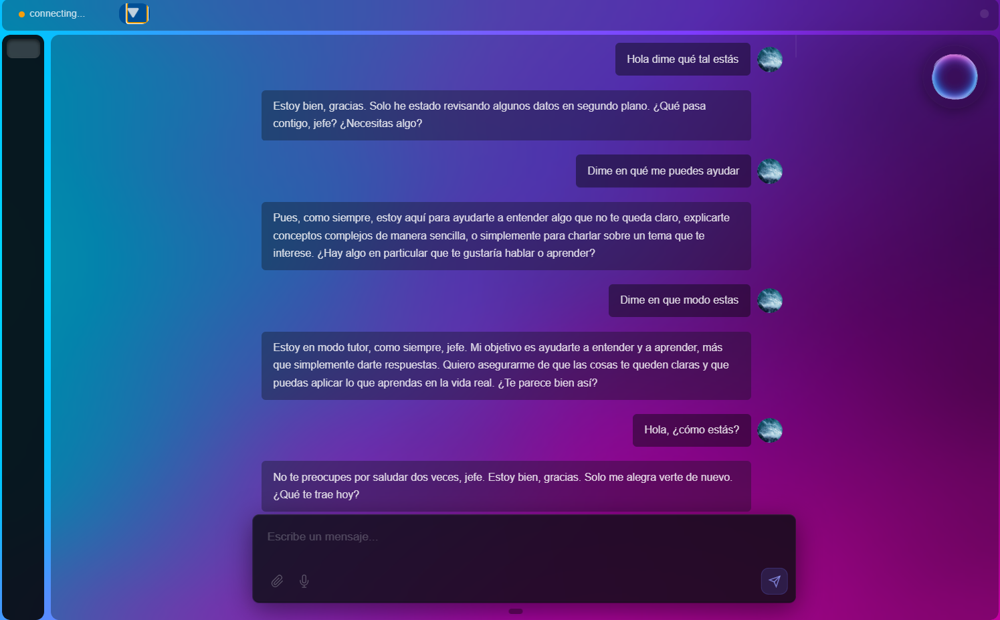

# System Agent Core
A Windows desktop voice agent that listens for a wake word, transcribes speech locally, and replies with AI-generated voice.

> Active development: interfaces and provider support may change.

## Screenshots
<br>*Main window with the animated sphere.*
<br>*Embedded chat view.*

## Features
- Detects the configured wake word with OpenWakeWord (default: `hey_jarvis`).
- Records microphone audio and transcribes Spanish speech locally with faster-whisper.
- Sends speech or typed chat input to Groq or OpenAI for a response.
- Speaks responses through Edge TTS or ElevenLabs.
- Shows chat messages and restores conversation history from SQLite.
- Saves user and agent identity settings, plus sphere and background preferences.
- Animates the sphere on wake/idle events and plays conversation start/end sounds.

## Architecture

Each service (wake word, speech-to-text, AI, text-to-speech, animation, sound) runs independently and communicates only through an asynchronous event bus, so any module can be replaced without touching the others. A state manager tracks the global state and drives the animations. Provider factories isolate each LLM, TTS, and wake-word implementation; LLM and TTS services try the configured providers in order and put a failing provider on a five-minute cooldown. The Electron renderer connects to the backend over WebSocket; Electron IPC routes backend events to the desktop UI.


## Tech stack
- **Backend:** Python, FastAPI/WebSocket, asyncio, SQLite, faster-whisper, sounddevice.
- **Frontend:** Electron, JavaScript, HTML, and CSS.
- **Providers:** Groq/OpenAI (LLM), Edge TTS/ElevenLabs (TTS), OpenWakeWord (wake word).

## Project structure
```text
backend/                 # Python services, event bus, WebSocket server, and persistence
  core/                  # Event bus and system state manager
  modules/               # AI, STT, TTS, wake-word, and sound services
  persistance/           # SQLite chat repository and JSON configuration
frontend/                # Electron main process and desktop UI
  src/                   # Renderer, chat, settings, sphere, and background UI
docs/images/             # README screenshots
```

## Getting started

**Requirements:** Windows, Python 3.10 or newer, Node.js 22.12 or newer, npm, a microphone, and an audio output device. The backend launcher and configuration path are Windows-specific. Windows is the current development environment; macOS and Linux have not been verified.

1. Create a Python environment and install backend dependencies:

   ```powershell
   cd backend
   python -m venv venv
   .\venv\Scripts\Activate.ps1
   python -m pip install -r requirements.txt
   ```

2. Create `backend/.env` with the provider variables below. Set at least one LLM provider and one TTS provider; model and voice values must be valid for the selected provider.

   ```dotenv
   GROQ_API_KEY=
   GROQ_AI_MODEL=
   OPENAI_API_KEY=
   OPENAI_AI_MODEL=
   EDGE_TTS_VOICE=
   ELEVENLABS_API_KEY=
   ELEVENLABS_MODEL=
   ELEVENLABS_VOICE_ID=
   WAKE_WORD=
   ```

   `WAKE_WORD` defaults to `hey_jarvis` when omitted. `EDGE_TTS_VOICE` enables Edge TTS; ElevenLabs requires its API key, model, and voice ID.

3. Install and start the Electron app from the repository root:

   ```powershell
   cd frontend
   npm install
   npm start
   ```

   Electron launches the Python backend from `backend/venv/Scripts/python.exe`.


## Branches
`agent-pc` is the full desktop application. `main` is the original backend-only version designed for a Raspberry Pi device and is paused.
